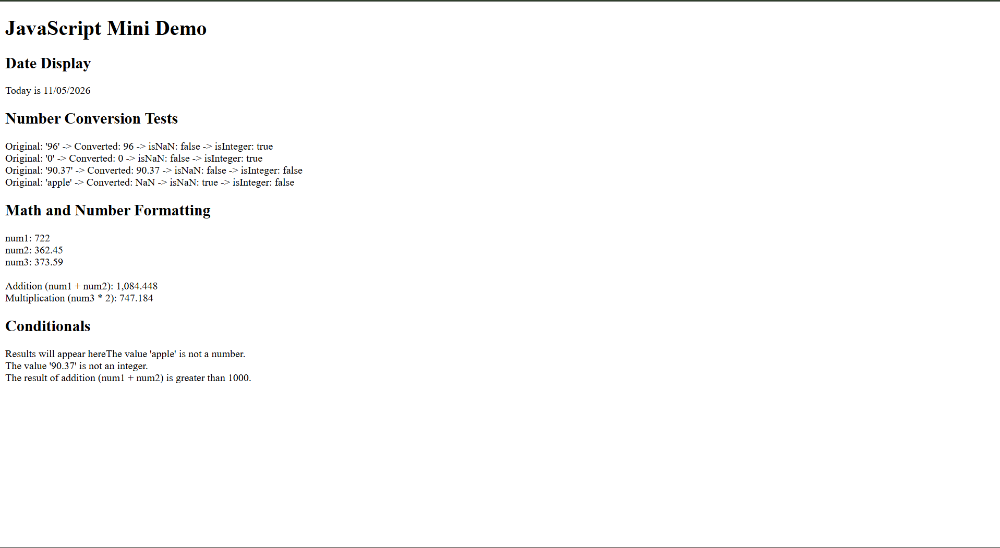

## Methods used

| Object/function |                     Methods used                         |                     Purpose                        |
| --- | --- | --- |
|     `Date`      | `new Date()`, `getMonth()`, `getDate()`, `getFullYear()` | Get the current date and its month, day, and year. |
|     `Math`      |             `Math.random()`, `Math.floor()`              | Generate random values and round selected values down to integers. |
|    `String`     |                        `String()`                        | Convert generated numbers into strings. |
|    `Number`     |      `Number()`, `Number.isNaN()`, `Number.isInteger()`  |  Convert strings and check the resulting numbers. |
| Number instances|              `toFixed()`, `toLocaleString()`             | Format numbers as strings for display. |

Screenshot path: 

Reflection: The easiest I would say was doing the addition or multiplication parts. The hardest probably was making the results show up 
properly on the main screen. I learned that the Date object provides the current date and time, and that its month numbering starts at zero.
I learned that Number() converts strings into numbers, while Number.isNaN() and Number.isInteger() help check the results. I also
learned how to display results using textContent and preserve line breaks with the CSS white-space property.

Sources: [MDN: Math.floor()](https://developer.mozilla.org/en-US/docs/Web/JavaScript/Reference/Global_Objects/Math/floor), [MDN: Math.random()](https://developer.mozilla.org/en-US/docs/Web/JavaScript/Reference/Global_Objects/Math/random), [MDN: white-space](https://developer.mozilla.org/en-US/docs/Web/CSS/Reference/Properties/white-space#pre-line).

